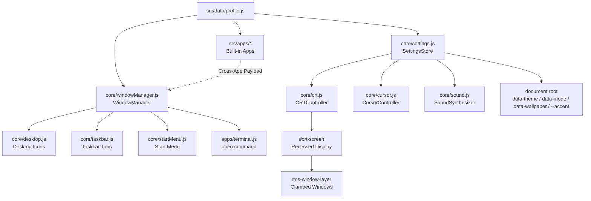

# DelMiiOS (AetherOS v2.4 — Combined Edition)

> A simulated retro-modern CRT desktop PC personal portfolio built with vanilla JavaScript, modern Vite, and **zero runtime dependencies**.

[](https://github.com/DelMiiYa/delmiios.git)
[](https://vitejs.dev/)
[](https://developer.mozilla.org/en-US/docs/Web/JavaScript)
[](https://vitest.dev/)
[](https://playwright.dev/)
[](LICENSE)

**Repository URL**: [https://github.com/DelMiiYa/delmiios.git](https://github.com/DelMiiYa/delmiios.git)

---

## Table of Contents

1. [Project Overview](#project-overview)
2. [Key Features](#key-features)
   - [CRT Monitor Frame & Hardware Simulation](#crt-monitor-frame--hardware-simulation)
   - [Custom Triangle Cursor & Continuous Canvas Trail](#custom-triangle-cursor--continuous-canvas-trail)
   - [Registry-Driven Window Manager](#registry-driven-window-manager)
   - [6 Built-in Applications & Cross-App Navigation](#6-built-in-applications--cross-app-navigation)
   - [Audio Synthesis Engine](#audio-synthesis-engine)
   - [Themes, Appearance & Persistence](#themes-appearance--persistence)
3. [Quick Start & CLI Commands](#quick-start--cli-commands)
4. [Architecture Overview](#architecture-overview)
   - [Directory Structure](#directory-structure)
   - [Subsystem Contracts & Data Flow](#subsystem-contracts--data-flow)
5. [How to Customize Personal Content](#how-to-customize-personal-content)
   - [Editing `src/data/profile.js`](#editing-srcdataprofilejs)
6. [How to Add a New Application (Registry Pattern)](#how-to-add-a-new-application-registry-pattern)
7. [How to Add a New Theme](#how-to-add-a-new-theme)
8. [Terminal Commands Reference](#terminal-commands-reference)
9. [Keyboard & Interaction Shortcuts](#keyboard--interaction-shortcuts)
10. [Deployment Guide](#deployment-guide)
11. [Testing & Quality Assurance](#testing--quality-assurance)
12. [License](#license)

---

## Project Overview

**DelMiiOS (AetherOS v2.4 — Combined Edition)** is a retro-futuristic personal portfolio designed as an interactive desktop operating system running inside a physical CRT monitor. It merges deep technical rigor with playful visual polish:

- **Zero Runtime Dependencies**: The entire operating system, window compositor, canvas renderer, Web Audio synthesizer, and app suite run on raw ES modules and standard browser APIs. Vite is used purely as a development server and build tool.
- **Architectural Modularity**: Built around an extensible Application Registry pattern. Adding an entirely new application requires only creating a single file and calling `windowManager.registerApp(myApp)`.
- **Sensory Polish**: Combines a physical CRT monitor bezel with scanlines, chromatic curvature, glass reflections, an *osu!*-inspired velocity-oriented triangle cursor with a fading continuous quadratic canvas trail, synthesized audio feedback, and 5 customizable themes with full dark/light mode support.
- **Honest Placeholder Data**: Shipped with clean, transparent placeholder structures in `src/data/profile.js` marked with clear `TODO` tags, making it simple for any developer to fork and turn into their own personal site.

---

## Key Features

### CRT Monitor Frame & Hardware Simulation
- **Desktop Bezel & Chin**: Rendered inside a theme-aware desktop chassis (`#crt-monitor`) complete with top bezel, recessed curved screen shell (`#crt-screen`), brand emblem badge plate (`AetherOS v2.4 CRT-17 SYNC`), and a physical **PWR** button with a dual-color LED (green when active, pulsing amber when asleep).
- **Shader Layers**: Non-interactive CSS overlay layers providing authentic scanlines, RGB phosphor mask, radial vignette, subtle screen curvature, and glass reflection.
- **Power On/Off Animations**: Authentic phosphor collapse-to-line/dot power-down and horizontal-line expand power-up animations triggered on boot, reboot, and sleep/wake.
- **Responsive Chassis**: On desktop viewports (`> 768px`), the monitor bezel frames the entire OS. On mobile viewports (`<= 768px`), the bezel automatically drops to maximize usable screen real estate, while maintaining CRT phosphor scanline effects.
- **Quick Controls**: Instant CRT toggle button in the taskbar tray, toggles in the Settings app, and a dedicated `crt [on|off|frame|scanlines|vignette|flicker]` terminal command.

### Custom Triangle Cursor & Continuous Canvas Trail
- **osu!-Style Directional Cursor**: Distinctive red equilateral triangle cursor (`--cursor-color`) featuring a pinpoint center hotspot dot.
- **Velocity Heading Rotation**: Cursor smoothly pivots in real-time to match the instantaneous angle of movement via shortest angular path calculations.
- **Continuous Idle Spin**: When pointer motion stops for more than `~180ms`, the triangle enters a continuous idle rotation (`~30 deg/s`).
- **Smooth Continuous Trail**: A full-viewport HiDPI `<canvas>` dynamically renders a fading white continuous line trail (`~380ms` decay) using quadratic bezier midpoints for silky curves.
- **Adaptive**: Automatically activates only on fine pointers (`(pointer: fine)`), respects `prefers-reduced-motion` by disabling spin and trail, and can be toggled via Settings or the `cursor` terminal command.

### Registry-Driven Window Manager
- **Pointer-Capture Dragging**: Smooth mouse and touch window moving using Pointer Events (`setPointerCapture` / `pointercancel`), preventing cursor slipping outside window bounds during fast movements.
- **Full Window Controls**: Minimize to taskbar, Maximize/Restore cascade bounds, and Close.
- **Double-Click Titlebar**: Instantly toggles between maximized and restored states.
- **Z-Index Layering**: Clicking any window immediately focuses and raises it to the foreground.
- **Clamped Cascading**: New windows cascade systematically and are strictly clamped within the bounds of the inner `#crt-screen` / `#os-window-layer`.
- **Mobile Auto-Maximize**: Windows automatically maximize when opened on screens `<= 768px` or when the viewport resizes below the breakpoint.

### 6 Built-in Applications & Cross-App Navigation

1. **`About Me.txt` (Notepad)**:
   - Text editor aesthetic with line numbers and monospace typography.
   - Summarizes personal background, technical interests, quick facts, and experience timeline.
   - Quick action buttons to launch **Projects** or **Contact**.
2. **`Projects` (File Explorer)**:
   - Dual-pane layout featuring folder navigation (`/home/username/projects`), category views, and project list.
   - Filter projects dynamically by technology tags (e.g., `TypeScript`, `Node.js`, `Vite`).
   - Detailed inspection card showing project date, status, overview, architecture details, live URLs, and source repository links.
   - Direct cross-app link: *"Discuss this project"* automatically opens the **Contact** application with the project title pre-filled in the subject line.
3. **`Skills` (System Monitor)**:
   - Displays simulated hardware specifications (OS name, kernel version, memory, uptime).
   - Categorized proficiencies with animated percentage bars and tags.
   - **Clickable Skill Tags**: Clicking any tag automatically launches **Projects** filtered specifically to projects utilizing that technology.
4. **`Contact` (Communications Center)**:
   - Direct email display, working hours, and social media links.
   - **Quick Message Composer**: Input fields for Subject and Message body that construct an RFC-compliant `mailto:` URI.
   - Action buttons: *Send Email* (opens default mail client) and *Copy Email* (with clipboard write and accessible `aria-live` tooltip confirmation).
5. **`Terminal` (Interactive Command Shell)**:
   - Authenticated terminal environment (`username@hostname:~$`).
   - Supports 14 commands (`help`, `about`, `projects`, `skills`, `contact`, `whoami`, `date`, `ls`, `cat`, `open`, `theme`, `sound`, `crt`, `cursor`, `clear`, `exit`).
   - Command history navigation via <kbd>↑</kbd> and <kbd>↓</kbd> keys.
   - Smart Tab-autocompletion for commands, app IDs, theme names, and virtual filesystem filenames.
   - Quick-command chip buttons for one-click command execution.
6. **`Settings` (Control Panel)**:
   - **Themes**: 5 visual styles (`Cyber Dark`, `Retro Teal 95`, `Sunset Dusk`, `Matrix Green`, `Clean Slate`).
   - **Mode**: Instant toggle between Dark and Light mode.
   - **Wallpapers**: 5 gradient and grid backgrounds (`Cyber Aurora`, `Synth Sunset`, `Architect Grid`, `Matrix Canopy`, `Classic Slate`).
   - **Accents**: 5 highlight colors (`Sky Blue`, `Electric Violet`, `Emerald Green`, `Warm Amber`, `Coral Rose`).
   - **Hardware Toggles**: CRT Frame, Scanlines, Vignette, Flicker, Custom Cursor, Canvas Trail, and Sound Effects.
   - **Reset to Defaults**: One-click restore back to the default profile configuration.

### Audio Synthesis Engine
- Built with standard Web Audio API oscillators and gain nodes—no external audio files required.
- Synthesizes realistic clicks, window snaps, boot chimes, command keystrokes, and power-down hums.
- Auto-gated by user interaction to satisfy browser autoplay policies.
- Mute/unmute toggle in the taskbar system tray and in Settings.

### Themes, Appearance & Persistence
- Entirely driven by CSS custom properties applied to root HTML attributes (`data-theme`, `data-mode`, `data-wallpaper`, `--accent`).
- All user preferences are persisted in a single versioned `localStorage` key (`delmiios_settings_v1`) with graceful fallback to defaults if storage is unavailable or corrupted.

---

## Quick Start & CLI Commands

### Prerequisites
- [Node.js](https://nodejs.org/) (version `18.0.0` or higher recommended)
- `npm` (version `9.0.0` or higher)

### Setup & Run

```bash
# 1. Clone the repository
git clone https://github.com/DelMiiYa/delmiios.git
cd delmiios

# 2. Install development dependencies
npm install

# 3. Start local Vite development server
npm run dev

# 4. Create production build in dist/
npm run build

# 5. Preview production build locally
npm run preview
```

### Testing Commands

```bash
# Run Vitest unit tests once (71 unit tests)
npm test
# or
npm run test:unit

# Run unit tests in watch mode
npx vitest

# Run Playwright end-to-end smoke tests (headless Chromium)
npm run test:e2e
```

---

## Architecture Overview

### Directory Structure

```
delmiios/
├── .agents/                   # Agent prompts, milestone plans, and review gates
├── public/                    # Static assets
│   └── favicon.svg            # Branded CRT icon
├── src/
│   ├── apps/                  # Application modules (Registry Pattern)
│   │   ├── about.js           # About Me.txt (Notepad)
│   │   ├── contact.js         # Contact & Quick Message Composer
│   │   ├── projects.js        # Projects File Explorer & Detail Pane
│   │   ├── settings.js        # Settings Control Panel
│   │   ├── skills.js          # Skills & System Specifications Monitor
│   │   └── terminal.js        # Terminal CLI shell & command interpreter
│   ├── core/                  # Operating System Subsystems
│   │   ├── boot.js            # Boot sequence & startup chime orchestration
│   │   ├── crt.js             # CRT monitor frame, overlays & power anims
│   │   ├── cursor.js          # Triangle cursor, canvas trail & heading math
│   │   ├── desktop.js         # Desktop shortcut icon grid
│   │   ├── icons.js           # Raw SVG icon library
│   │   ├── settings.js        # SettingsStore & localStorage manager
│   │   ├── sound.js           # Web Audio API synthesizer
│   │   ├── startMenu.js       # Start Menu flyout & live app search
│   │   ├── taskbar.js         # Taskbar tabs, clock & system tray
│   │   └── windowManager.js   # Window compositor, pointer drag & clamping
│   ├── data/
│   │   └── profile.js         # Single Source of Truth for portfolio content
│   ├── main.js                # Bootstrap entry point & app registration
│   └── style.css              # Main design tokens, theme definitions & styles
├── tests/
│   ├── e2e/
│   │   └── smoke.spec.js      # Playwright 9-scenario browser test suite
│   └── unit/
│       ├── cursorMath.test.js # Vitest trigonometry & trail pruning tests
│       ├── settings.test.js   # Vitest SettingsStore state & persistence tests
│       ├── terminal.test.js   # Vitest parser, XSS escaping & autocomplete tests
│       └── windowManager.test.js # Vitest cascade & coordinate clamping tests
├── index.html                 # HTML shell & viewport configuration
├── package.json               # Scripts & devDependencies
├── playwright.config.js       # Playwright E2E configuration
├── vite.config.js             # Vite bundler config with base: './'
└── vitest.config.js           # Vitest unit test runner config
```

### Subsystem Contracts & Data Flow



1. **Profile (`src/data/profile.js`)**: Pure data module containing identity, projects, skills, contact links, and default system settings. No DOM dependencies.
2. **Settings Store (`src/core/settings.js`)**: Reactive state container. Emits change events to subscribers and applies CSS custom properties and classes to `document.documentElement` and `#crt-screen`.
3. **Window Manager (`src/core/windowManager.js`)**: Manages window lifecycle, z-indexing, pointer-capture dragging, minimizing, maximizing, and coordinate clamping within `#crt-screen`.
4. **Application Registry**: Applications are registered via `windowManager.registerApp(appDef)`. The registry automatically generates desktop icons, start menu entries, taskbar tabs, and terminal commands.

---

## How to Customize Personal Content

All portfolio content is centralized in **[`src/data/profile.js`](file:///D:/delmiios/src/data/profile.js)**. Simply edit the exported `profile` object to replace the placeholders.

### Key Sections to Update in `src/data/profile.js`:

```javascript
export const profile = {
  // 1. Personal Identity
  name: 'Jane Doe',                     // TODO: Your real name
  username: 'janedoe',                  // TODO: Your preferred username
  hostname: 'workstation',              // TODO: Terminal hostname
  role: 'Senior Frontend Engineer',     // TODO: Your professional title
  tagline: 'Crafting responsive, high-performance web systems.',
  location: 'San Francisco, CA',        // TODO: Your location
  status: 'Open for interesting roles', // TODO: Current status
  avatarInitials: 'JD',                 // Derived automatically if omitted

  // 2. About Me Content
  about: {
    fileName: 'About Me.txt',
    summary: [
      'Write your personal intro paragraph here...',
      'Share your background, achievements, and technical philosophy.'
    ],
    interests: [
      'Web Architecture',
      'Design Systems',
      'Creative Coding'
    ],
    quickFacts: [
      { label: 'Location', value: 'San Francisco, CA' },
      { label: 'Experience', value: '7+ Years' },
      { label: 'Focus', value: 'Frontend & UI Performance' }
    ],
    experience: [
      {
        role: 'Lead UI Engineer',
        company: 'Vanguard Tech',
        period: '2023 — Present',
        highlights: [
          'Engineered micro-frontend design system across 4 engineering teams.',
          'Reduced web application bundle sizes by 42% using vanilla ES modules.'
        ]
      }
    ]
  },

  // 3. Featured Projects
  projects: [
    {
      id: 'proj-1',
      title: 'NeonEngine',
      category: 'Web Application',
      date: '2026',
      status: 'Production',
      description: 'A WebGL shader editor and real-time visualization tool.',
      details: 'Built with vanilla WebGL, Vite, and custom GLSL compilation pipeline.',
      tech: ['JavaScript', 'WebGL', 'Vite', 'HTML/CSS'],
      liveUrl: 'https://neonengine.example.com',
      repoUrl: 'https://github.com/janedoe/neonengine'
    }
  ],

  // 4. Skills & System Monitor Specs
  skills: {
    systemSpecs: {
      osName: 'AetherOS v2.4',
      osCodename: 'CRT Edition',
      kernel: 'Vanilla-JS Microkernel 64-bit',
      uptime: '99.98% Reliable',
      memory: '32.0 GB Virtual RAM'
    },
    categories: [
      {
        name: 'Languages & Core',
        description: 'Core web standards and typing',
        items: [
          { name: 'TypeScript', level: 95, tag: 'Language', filterTag: 'TypeScript' },
          { name: 'JavaScript (ESNext)', level: 95, tag: 'Language', filterTag: 'JavaScript' }
        ]
      }
    ]
  },

  // 5. Contact Channels & Socials
  contact: {
    email: 'jane@example.com',
    availabilityNote: 'Available for full-time senior engineering opportunities.',
    officeHours: 'Monday — Friday, 09:00 - 17:00 PST',
    socials: [
      {
        platform: 'GitHub',
        handle: '@janedoe',
        url: 'https://github.com/janedoe',
        description: 'Source code repositories and open-source contributions'
      },
      {
        platform: 'LinkedIn',
        handle: 'in/janedoe',
        url: 'https://linkedin.com/in/janedoe',
        description: 'Professional career history and connections'
      }
    ]
  },

  // 6. System Defaults
  system: {
    defaultTheme: 'cyber-dark',      // 'cyber-dark' | 'retro-teal' | 'sunset-dusk' | 'matrix' | 'clean-slate'
    defaultMode: 'dark',             // 'dark' | 'light'
    defaultWallpaper: 'aurora',      // 'aurora' | 'sunset' | 'blueprint' | 'emerald' | 'minimal'
    defaultAccent: '#38bdf8',        // Hex color
    soundEnabled: true,
    crtFrame: true,
    crtScanlines: true,
    crtVignette: true,
    crtFlicker: false,
    customCursor: true,
    cursorTrail: true
  }
};
```

---

## How to Add a New Application (Registry Pattern)

Adding an application to DelMiiOS requires no manual modification to desktop icon templates, start menu items, taskbar loops, or terminal dispatchers. Simply define your app and register it with the `WindowManager`.

### Step 1: Create the Application Module

Create `src/apps/notes.js`:

```javascript
/**
 * Simple Notes Application
 */
export const notesApp = {
  id: 'notes',                                // Unique identifier (kebab-case)
  title: 'Scratchpad Notes',                  // Window titlebar text
  shortTitle: 'Notes',                        // Taskbar button label
  desktopLabel: 'Notes',                      // Desktop icon label
  description: 'Quick client-side scratchpad',// Start menu tooltip / description
  icon: `
    <svg viewBox="0 0 24 24" width="22" height="22" fill="none" stroke="currentColor" stroke-width="2">
      <path d="M14 2H6a2 2 0 0 0-2 2v16a2 2 0 0 0 2 2h12a2 2 0 0 0 2-2V8z"/>
      <polyline points="14 2 14 8 20 8"/>
      <line x1="16" y1="13" x2="8" y2="13"/>
      <line x1="16" y1="17" x2="8" y2="17"/>
    </svg>
  `,
  defaultWidth: 500,                          // Default window width (px)
  defaultHeight: 400,                         // Default window height (px)

  /**
   * Render function called when the window is first opened.
   * @param {HTMLElement} container - Window body element
   * @param {Object} ctx - Application runtime context
   * @param {Function} ctx.openApp - (appId, payload) => void
   * @param {Function} ctx.close - () => void
   * @param {Object} [ctx.payload] - Optional payload passed upon launch
   * @returns {Object} Optional lifecycle hooks: { cleanup, onFocus, onPayload }
   */
  render(container, ctx) {
    container.innerHTML = `
      <div style="display:flex; flex-direction:column; height:100%; padding:12px; gap:8px;">
        <label for="scratchpad-text" style="font-weight:600; font-size:12px; color:var(--text-secondary);">
          SCRATCHPAD (Auto-saved)
        </label>
        <textarea id="scratchpad-text" style="
          flex:1; background:var(--bg-input); color:var(--text-primary);
          border:1px solid var(--border-color); border-radius:4px;
          padding:10px; font-family:var(--font-mono); resize:none;
        " placeholder="Type your notes here..."></textarea>
      </div>
    `;

    const textarea = container.querySelector('#scratchpad-text');
    const storageKey = 'delmiios_notes_content';
    textarea.value = localStorage.getItem(storageKey) || '';

    const handleInput = () => {
      localStorage.setItem(storageKey, textarea.value);
    };
    textarea.addEventListener('input', handleInput);

    // Optional lifecycle hooks
    return {
      cleanup() {
        textarea.removeEventListener('input', handleInput);
      },
      onFocus() {
        textarea.focus();
      },
      onPayload(payload) {
        if (payload && payload.append) {
          textarea.value += `\n${payload.append}`;
          handleInput();
        }
      }
    };
  }
};
```

### Step 2: Register in `src/main.js`

Open `src/main.js`, import your new application, and register it:

```javascript
import { notesApp } from './apps/notes.js';

// Inside initOS():
[aboutApp, projectsApp, skillsApp, contactApp, terminalApp, settingsApp, notesApp].forEach((app) => {
  windowManager.registerApp(app);
});
```

**That's it!** The application is now fully integrated:
- Appears on the **Desktop** as a clickable shortcut icon.
- Appears in the **Start Menu** and can be searched via the live filter.
- Tracks active state and minimizes/restores from the **Taskbar**.
- Can be launched from the **Terminal** via `open notes`.

---

## How to Add a New Theme

DelMiiOS uses a declarative theme system powered by CSS custom properties.

### 1. Register in `src/data/profile.js`
Add your theme descriptor to `profile.appearance.themes`:

```javascript
appearance: {
  themes: [
    // Existing themes...
    {
      id: 'synth-neon',
      name: 'Synth Neon',
      color: '#8b5cf6',
      desc: 'Vibrant neon purple and cyberpunk cyan'
    }
  ]
}
```

### 2. Allow Theme in `src/core/settings.js`
Add your theme ID to the `VALID_THEMES` array:

```javascript
export const VALID_THEMES = [
  'cyber-dark',
  'retro-teal',
  'sunset-dusk',
  'matrix',
  'clean-slate',
  'synth-neon' // <-- Add here
];
```

### 3. Define CSS Variables in `src/style.css`
Define your theme's color tokens under `[data-theme='synth-neon']`:

```css
/* Theme: Synth Neon */
[data-theme='synth-neon'] {
  --bezel-bg: #1f1135;
  --bezel-border: #3c1e69;
  --bezel-highlight: #5b28a0;
  --bezel-shadow: rgba(0, 0, 0, 0.9);
  --bg-surface: rgba(30, 15, 55, 0.94);
  --bg-surface-solid: #1e0f37;
  --bg-elevated: #321858;
  --bg-elevated-hover: #48237c;
  --bg-input: #120724;
  --bg-titlebar: #241142;
  --bg-titlebar-active: #4a1d7d;
  --bg-taskbar: rgba(22, 10, 42, 0.95);
  --text-primary: #f5f3ff;
  --text-secondary: #c4b5fd;
  --text-muted: #8b5cf6;
  --border-color: rgba(167, 139, 250, 0.3);
  --border-focused: #a78bfa;
  --shadow-win: 0 20px 45px rgba(0, 0, 0, 0.7), 0 0 0 1px var(--border-color);
  --shadow-win-focused: 0 24px 55px rgba(0, 0, 0, 0.8), 0 0 0 1.5px #a78bfa;
}
```

The new theme is immediately selectable from the **Settings** app, terminal (`theme synth-neon`), and persists across reloads.

---

## Terminal Commands Reference

The built-in Terminal provides 14 interactive commands with history (<kbd>↑</kbd>/<kbd>↓</kbd>) and Tab autocompletion:

| Command | Arguments | Description | Example |
| :--- | :--- | :--- | :--- |
| `help` | `[command]` | Lists all commands or explains specific syntax | `help theme` |
| `about` | — | Displays biographical summary directly in terminal | `about` |
| `projects` | — | Lists all portfolio projects, categories, and technologies | `projects` |
| `skills` | — | Displays system hardware specs and technical proficiencies | `skills` |
| `contact` | — | Outputs direct contact channels, hours, and social handles | `contact` |
| `whoami` | — | Prints current active user and permission privileges | `whoami` |
| `date` | — | Displays the current system date, time, and timezone | `date` |
| `ls` | — | Lists virtual filesystem files in `/home/user/` | `ls` |
| `cat` | `<filename>` | Outputs contents of a virtual file (`About_Me.txt`, etc.) | `cat About_Me.txt` |
| `open` | `<app-id>` | Launches or focuses a desktop application window | `open projects` |
| `theme` | `[name]` | Changes theme (`cyber-dark`, `retro-teal`, `sunset-dusk`, `matrix`, `clean-slate`, `dark`, `light`) | `theme matrix` |
| `sound` | `[on\|off]` | Toggles or sets Web Audio synthesizer sound effects | `sound off` |
| `crt` | `[mode]` | Controls CRT features (`on`, `off`, `frame`, `scanlines`, `vignette`, `flicker`) | `crt flicker` |
| `cursor` | `[mode]` | Controls cursor options (`on`, `off`, `trail`, `notrail`) | `cursor trail` |
| `clear` | — | Clears the terminal screen buffer (<kbd>Ctrl</kbd>+<kbd>L</kbd>) | `clear` |
| `exit` | — | Closes the Terminal window | `exit` |

---

## Keyboard & Interaction Shortcuts

| Context | Action / Shortcut | Result |
| :--- | :--- | :--- |
| **Boot Screen** | <kbd>Space</kbd> or <kbd>Enter</kbd> or Click | Skips boot sequence and immediately loads desktop |
| **Desktop Icons** | Double-Click or <kbd>Enter</kbd> / <kbd>Space</kbd> | Opens the selected application |
| **Window Titlebar** | Click & Drag | Smoothly repositions window with Pointer Capture |
| **Window Titlebar** | Double-Click | Toggles between maximized and restored size |
| **Window Controls** | Minimize button (`_`) | Minimizes window to taskbar |
| **Window Controls** | Maximize button (`□`) | Toggles window maximization |
| **Window Controls** | Close button (`✕`) | Closes window and runs app cleanup |
| **Window Surface** | Click anywhere | Raises window to foreground (z-index focus) |
| **Start Menu** | Click Start Button | Toggles Start Menu flyout |
| **Start Menu** | <kbd>Escape</kbd> or Click Outside | Closes Start Menu |
| **Start Menu** | Type any letters | Live-filters the applications list |
| **Terminal** | <kbd>↑</kbd> / <kbd>↓</kbd> | Cycles backward/forward through command history |
| **Terminal** | <kbd>Tab</kbd> | Autocompletes commands, app IDs, themes, or file names |
| **Terminal** | <kbd>Ctrl</kbd> + <kbd>L</kbd> | Clears terminal screen buffer |
| **Taskbar Tray** | Click CRT Icon | One-click master toggle for CRT visual effects |
| **Taskbar Tray** | Click Audio Icon | Toggles system sound effects on/off |
| **Physical PWR** | Click PWR Button | Suspends the system (sleep mode) / Wakes system |
| **Sleep Overlay** | Click anywhere | Wakes system from suspend mode |

---

## Deployment Guide

DelMiiOS is built as a static client-side bundle with no backend dependencies.

### GitHub Pages Deployment

`vite.config.js` is already configured with `base: './'`, enabling deployment to root domains, subdirectories, or GitHub Pages out of the box:

```javascript
// vite.config.js
import { defineConfig } from 'vite';

export default defineConfig({
  base: './', // Relative base path ensures assets resolve correctly on GitHub Pages
  build: {
    outDir: 'dist',
    assetsDir: 'assets'
  }
});
```

#### Deploying with GitHub Actions

Create `.github/workflows/deploy.yml`:

```yaml
name: Deploy DelMiiOS to GitHub Pages

on:
  push:
    branches: [ main ]

permissions:
  contents: read
  pages: write
  id-token: write

concurrency:
  group: 'pages'
  cancel-in-progress: true

jobs:
  build-and-deploy:
    environment:
      name: github-pages
      url: ${{ steps.deployment.outputs.page_url }}
    runs-on: ubuntu-latest
    steps:
      - name: Checkout
        uses: actions/checkout@v4

      - name: Setup Node
        uses: actions/setup-node@v4
        with:
          node-version: 20
          cache: 'npm'

      - name: Install Dependencies
        run: npm ci

      - name: Run Tests
        run: npm test

      - name: Build Project
        run: npm run build

      - name: Upload Artifact
        uses: actions/upload-pages-artifact@v3
        with:
          path: './dist'

      - name: Deploy to GitHub Pages
        id: deployment
        uses: actions/deploy-pages@v4
```

### Static Hosts (Vercel, Netlify, Cloudflare Pages)

- **Build Command**: `npm run build`
- **Output Directory**: `dist`
- **Node Version**: `18.x` or `20.x`

---

## Testing & Quality Assurance

DelMiiOS maintains 100% pass rates across both unit tests and end-to-end browser smoke tests.

### Unit Tests ([Vitest](https://vitest.dev/))
71 unit tests verify core computational logic in isolation:
- `tests/unit/cursorMath.test.js`: Verifies heading angles, shortest angular delta, idle thresholds, trail points timestamp pruning, and quadratic bezier midpoint generation.
- `tests/unit/settings.test.js`: Verifies state synchronization, mode flipping, input validation, corrupted `localStorage` recovery, and `resetDefaults()`.
- `tests/unit/terminal.test.js`: Verifies pure HTML escaping against XSS injection, whitespace tokenization, and multi-prefix Tab autocompletion.
- `tests/unit/windowManager.test.js`: Verifies cascade calculations, inner `#crt-screen` coordinate clamping, boundary safety, and responsive dimensions.

```bash
npm run test:unit
```

### End-to-End Smoke Tests ([Playwright](https://playwright.dev/))
9 full browser scenarios covering real user interactions:
1. **Boot Sequence & Auto-Launch**: CRT frame render, skip sequence (<kbd>Space</kbd>/button), and automatic launch of `About Me.txt`.
2. **Application Opening & Singularity**: Launches all 6 applications; verifies no duplicate window instances are created.
3. **Window Mechanics**: Titlebar pointer-drag, minimize/restore, maximize/restore, and window closing.
4. **Start Menu & Suspension**: Real-time app search filtering and sleep/wake state transitions via power button.
5. **Persistence**: Confirms theme, CRT shaders, and cursor preferences persist across page reloads.
6. **Quick Message Composer**: Input validation, clipboard copy feedback, and `mailto:` action construction.
7. **Cross-App Navigation**: Seamless navigation with payloads (Projects &rarr; Contact, Skills &rarr; Projects).
8. **Terminal Execution**: Command output verification (`help`, `ls`, `cat`, `theme`, `crt`, `cursor`) and Tab autocomplete.
9. **Mobile Responsiveness (390×844)**: Responsive viewport verification ensuring CRT bezel drops cleanly and open windows auto-maximize.

```bash
npm run test:e2e
```

---

## License

This project is licensed under the **MIT License**. Feel free to use, modify, and distribute it for your personal portfolios or creative web projects.

Built with curiosity and nostalgia by [Your Name](https://github.com/DelMiiYa/delmiios.git).
